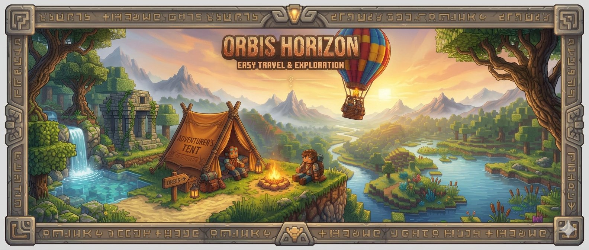

Orbis Horizon is an adventure mod for Hytale about leaving home behind. You build your gear at the workbench, carry it in a crate, and set it up wherever the road takes you. A tent for the night, a hot air balloon to cross the valley, an airship once the world starts to feel small, and balloon stations that fly you from one place to the next.

When it's time to move on, the camp folds back into its pack and the balloon lands wherever you choose.

The mod is still in development, and more gear is on the way.

## What you can take with you

### Camps

Your camp now fits in a leather backpack that you can see on your back. The sleeping bag is where it starts: a straw bed and a little fire, set up in a second and good for one night. Wake up after a full night and it packs itself away.

Upgrade the sleeping bag into the Small tent: a bed, a campfire, a stool, a lantern and a little chest outside. Upgrade that into the Large tent, a proper base camp for two with chests to keep what you found along the way. Every upgrade keeps what you left inside.

Wherever you sleep, that is where you come back if the road is unkind, even after you have packed the camp.

### Hot air balloons

Fill the burner with fuel, climb into the basket, pull the chain, and the ground drops away. You fly freely as long as the burner has something to burn. Pull the chain again to stop, on the ground or right there in the sky. If the fuel runs out, the balloon sinks gently back to earth.

- The small balloon is for travelling alone.
- The large balloon takes your friends along on its stools and carries chests full of supplies.
- The animal transport balloon has an iron cage hanging under its basket. Lower it onto a meadow, lure an animal in with its favourite food, close the cage and fly your new livestock home.

### The Cloudwork airship

A flying ship with a whole workshop on board: every workbench you need, beds, chests and seats for a crew. It floats without fuel and only burns fuel while it moves or turns. It goes where you fly and turns to face where you look. Building it is a long road, with rare materials from deep in the world.

You can hire a pilot at any station. Ask them to take you to one of your map markers or to a station and they fly the ship while you sit in the captain's chair, or pick the destination on the chart in the cabin. Parked far away, the airship comes to a station when you call it, and you climb a ladder to board.

### The steamboat

A paddle steamer you set down on a lake, a river or the sea, with a workshop on board like the airship. Fuel the tank, stand at the helm and cast off. It sails on the surface, backs up slowly, and its two paddle wheels turn as it goes. Smoke rises from its chimneys while it is moored, and thickens when it sails. The airship, too, smokes lightly from its rear burners while parked with fuel.

### Balloon stations

A station is a stone walkway with a landing pad at its end and a little hut for the station master. Name it when you set it up. Talk to the station master, pick a faraway station, and a balloon floats down onto the pad. Climb in, sit on a stool, and when the countdown ends it carries you across the sky on its own while you watch it fly from the outside. You step off on the boarding platform of the other station, with its name across the screen. No fuel to find, nothing to steer. Every station anyone sets up is a stop for everybody.

## Before you set off

- Everything is crafted at the Explorer's workbench, an explorer's desk with its own tabs. Upgrade it and plans and little models of what you can build appear on top of it, down to a balloon floating above the bench. Each vehicle is a single recipe, with no parts to make first.
- Hold a crate and you see where the structure will go, block by block, before you set it up.
- Pack a camp and what you left in its chests and campfire travels in the pack, ready for your next camp. The small tent has a chest outside for your things.
- Once set up, a tent, balloon, airship or station is locked, so nobody breaks it by accident. Beds, chests, burners and seats still work.
- Friends standing on board when you take off travel with you, seated, and watch the sky from outside the vehicle. Passengers can leave mid-flight with a glider. Other players see you fly by.
- Stations keep a clear area around their landing pad, and you can only own one airship at a time.

Orbis Horizon 1.8 needs Hytale 0.7. Version 1.5 is the last one for Hytale 0.6.8.

The wiki has the exact recipes, how to fly each vehicle and the operator commands.

## Telemetry

The mod quietly reports how many servers use it and which features get used, and it reports its own errors, so bugs can be found faster. No player name, position or world ever leaves your server, and the server owner can switch it off at any time. The details are in the [wiki](https://github.com/keepkoolz/orbis-horizon/wiki#telemetry).

## Changelog

The changes of each version are listed in [CHANGELOG.md](CHANGELOG.md).

## Credits and sources

- The large hot air balloon prefab is based on [Hot Air Ballon](https://www.curseforge.com/hytale/prefabs/hot-air-ballon). It has been modified for this mod (burner, take-off chain, ladder, removed blocks). Check the reuse terms on its page before distributing the mod.
- The airship prefab is based on [Starter Airship: The Cloudwork (V.2)](https://www.curseforge.com/hytale/prefabs/the-cloudwork). It has been modified for this mod (burners, helm used for take-off, etc.). Check the reuse terms on its page before distributing the mod.
- The tent prefabs are based on [Desert Base Camp - Tent (Model 2)](https://www.curseforge.com/hytale/prefabs/desert-base-camp-tent-model-2) and [Desert Base Camp - Tent (Model 1)](https://www.curseforge.com/hytale/prefabs/desert-base-camp-tent). They have been modified for this mod (added, moved and removed blocks). Check the reuse terms on their pages before distributing the mod.
- The 3D flight model and its texture are generated from the prefab using the game's block textures. These textures, and the game assets copied or adapted for the mod, belong to Hypixel Studios.
- The way the camp pack is drawn on your back is inspired by [True Backpack](https://github.com/SupremoSama/Hytale-TrueBackpack), published under the CC0 licence (public domain). The code was rewritten for this mod.

## Licence

The original code and content of this mod are licensed under the [PolyForm Noncommercial License 1.0.0](LICENSE). You can use, copy and modify them for noncommercial purposes, and commercial use is not permitted. The prefabs and the game assets listed in [NOTICE](NOTICE) are not covered by this licence.

### Terms of use for this mod in your adventures

If you use this mod in a modpack, on your server or elsewhere, please provide the URL of this mod's page.
The commercial distribution of content containing all or part of this mod is prohibited.
